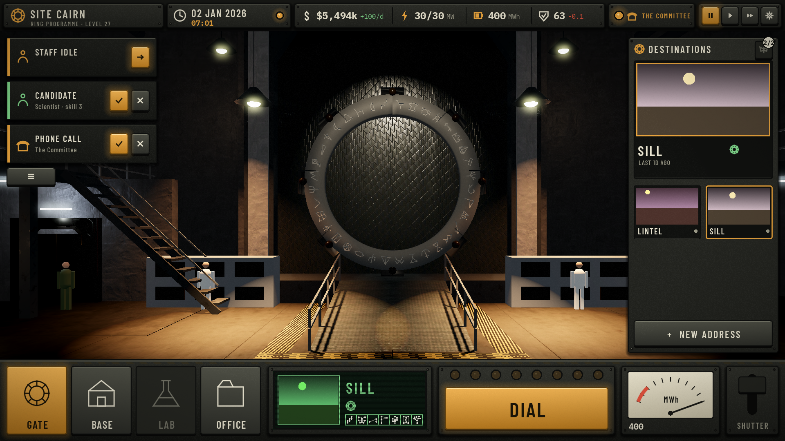
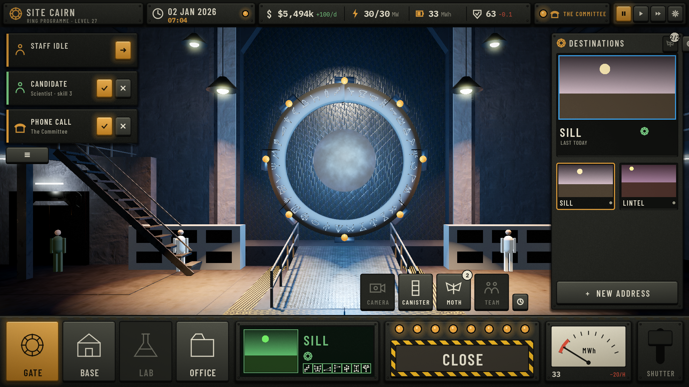
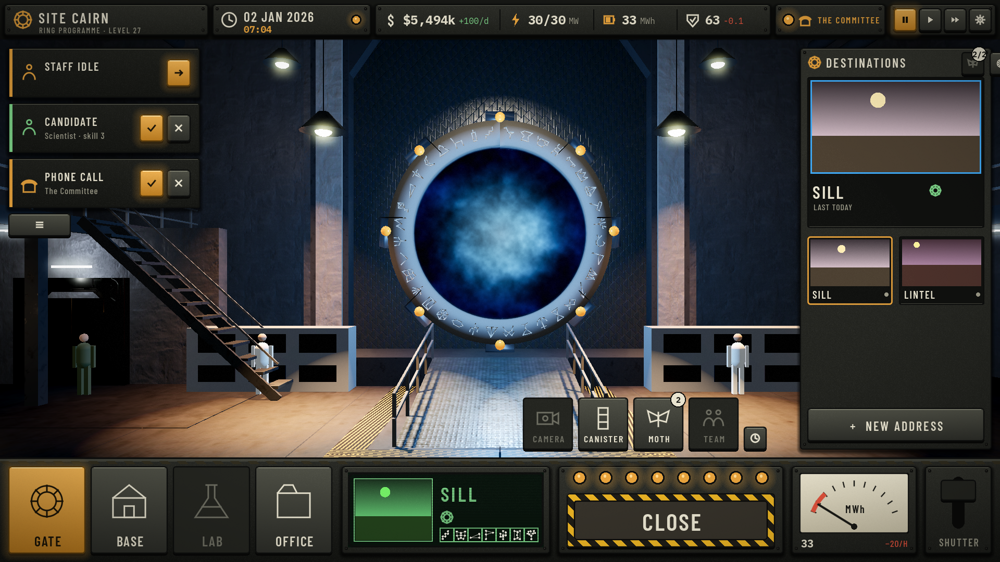
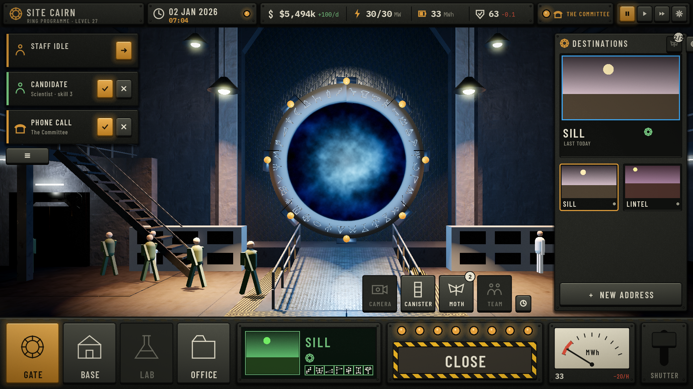
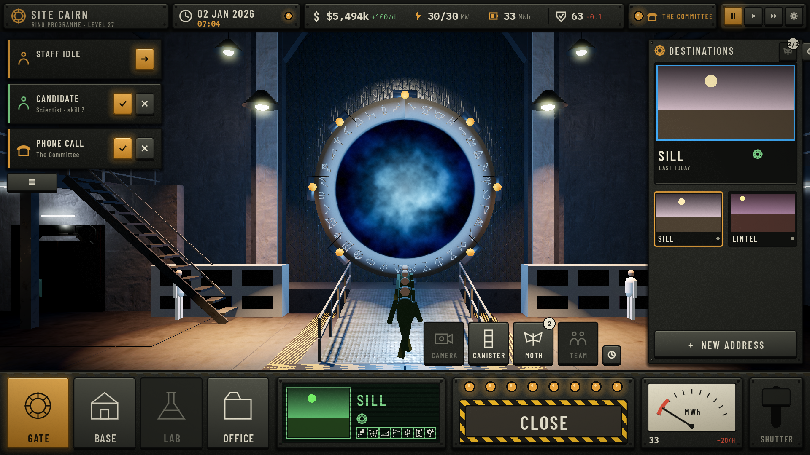
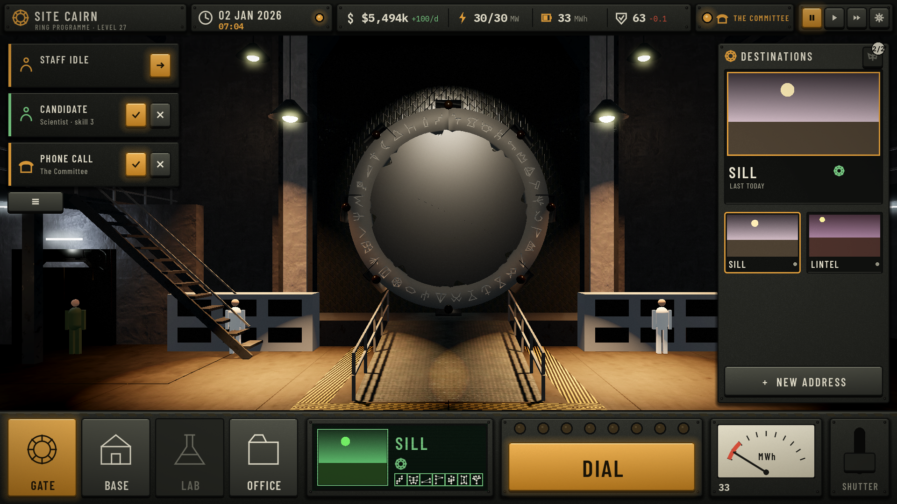
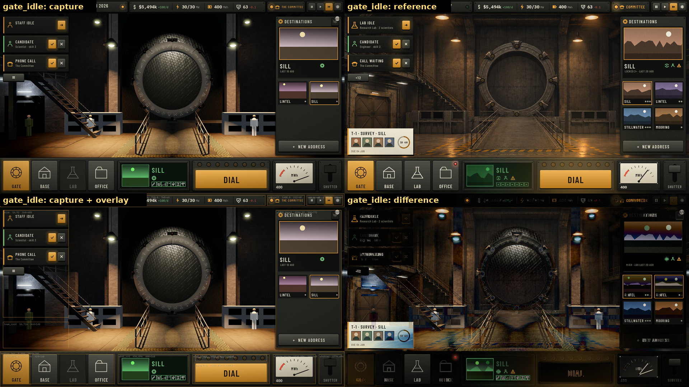
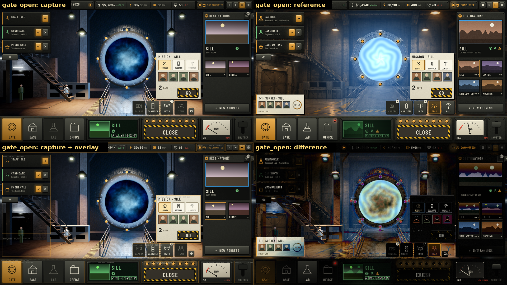
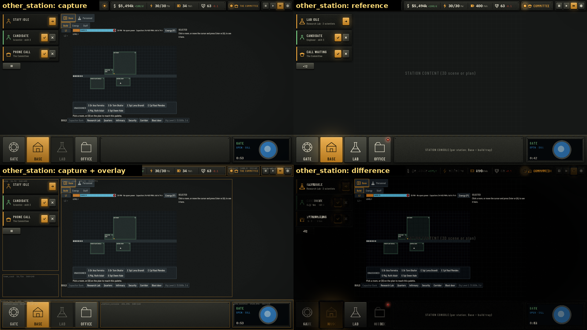

# M5 playtest: the Gate hall in 3D

The Gate station is now a real-time 3D hall (M5-01 to M5-04): the hall built from the
MegaKit with the owner's baked lightmaps (#524), the code-built Ring and event horizon, and
low-poly figures driven by the floor cues. Captured at 1920 × 1080 on software GL in the
container (the baked lightmap is dropped for captures there; static lamps light live).

## Plate path

**Kept as the fallback**, not removed: `display/stations_3d` (default on) turns the hall off
for low-end machines, and headless runs (tests, the soak) always use the plate, so the soak
is unaffected. The 2D ring, horizon, light, Shutter and actor layers stand down when the
station is 3D.

## States

| | |
| --- | --- |
| Idle  | Dialling  |
| Opening surge  | Open  |
| Team leaving  | Team returning  |
| Incursion breach  | Shutter closed  |

## Reference comparisons

## Budget

Whole frame including the UI at 1080p medium: about 1,060 draw calls and 93k primitives idle,
1,250 and 104k open (two shadowed lamps; the rest baked or unshadowed).
