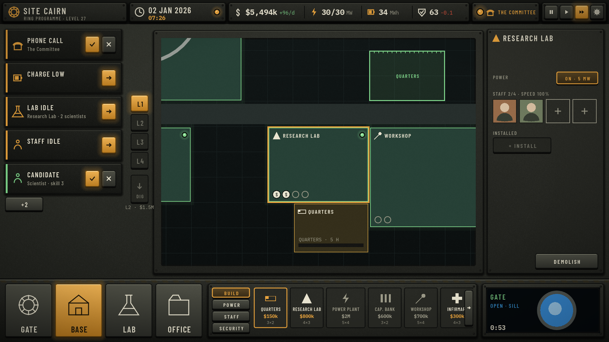
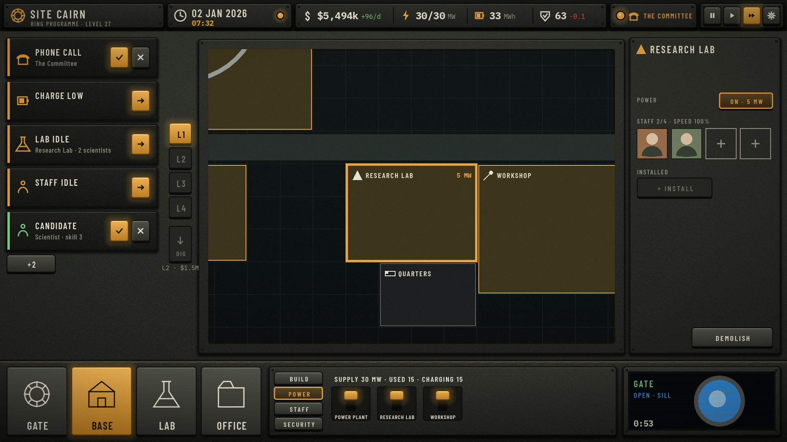
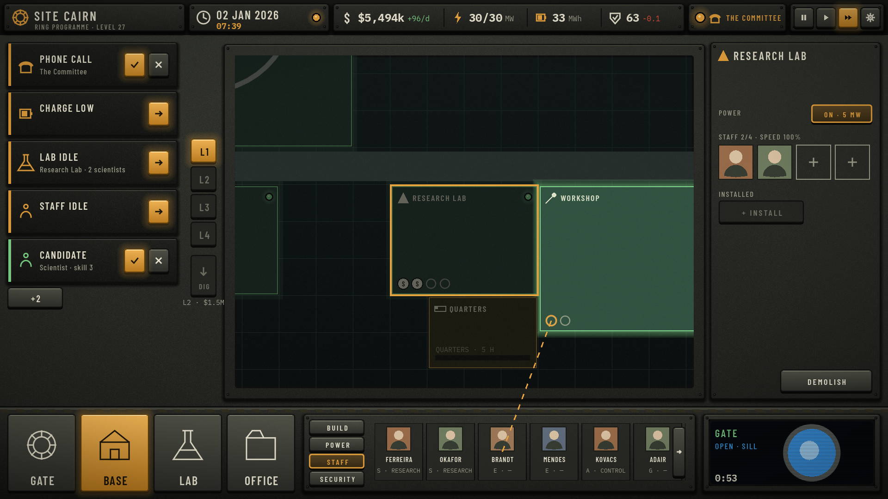
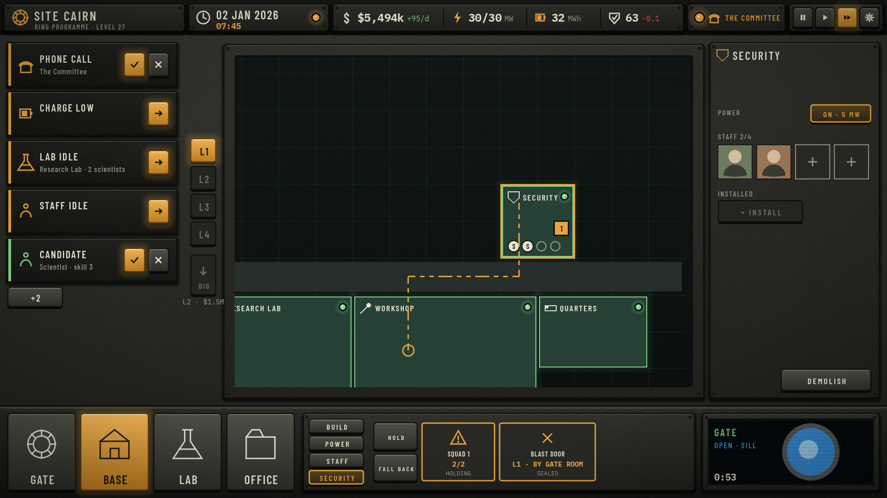
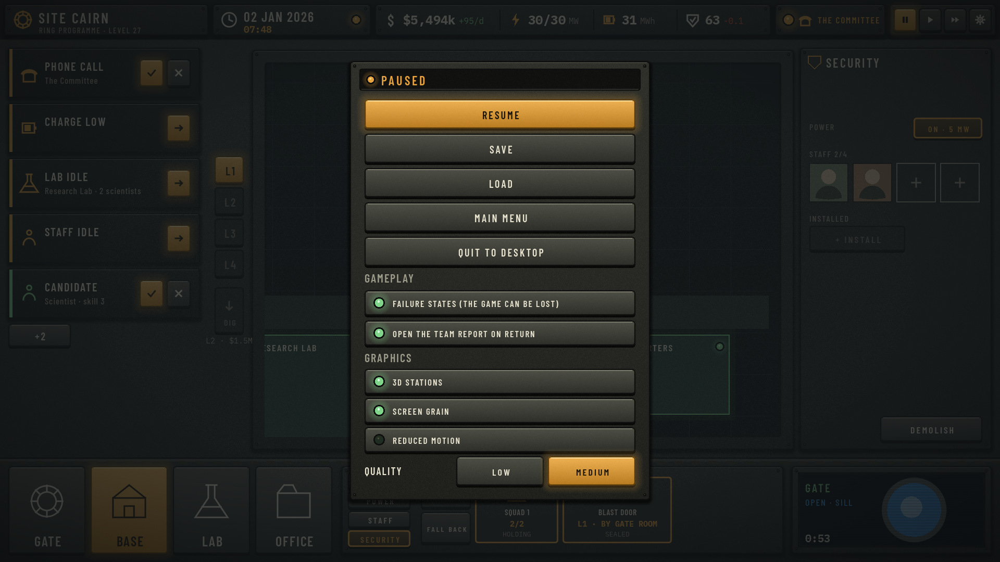
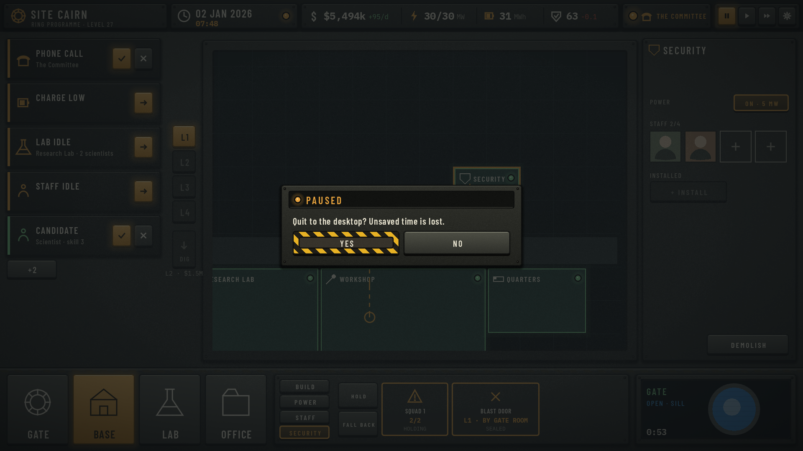
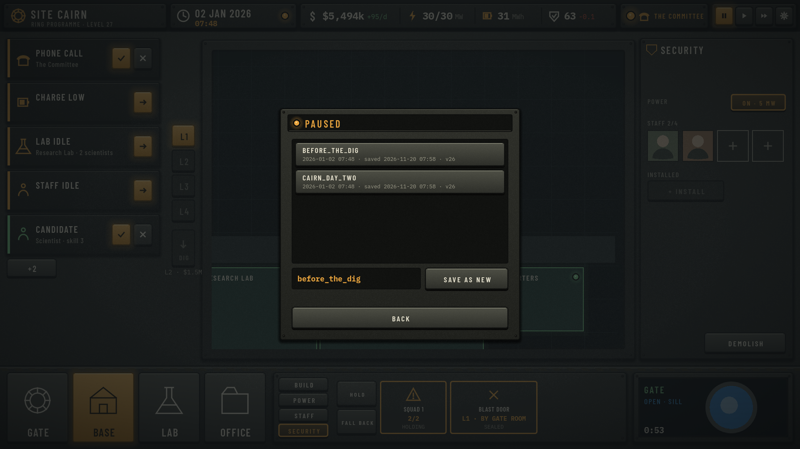
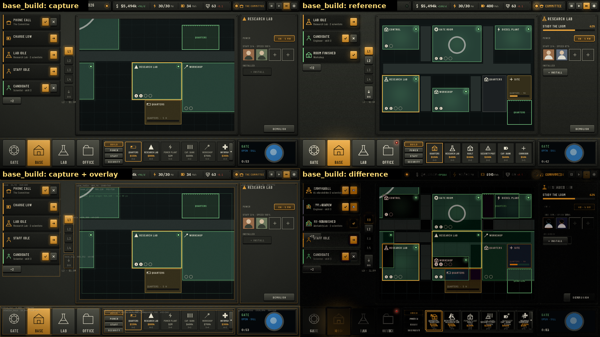
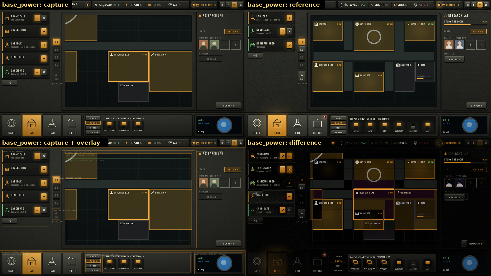
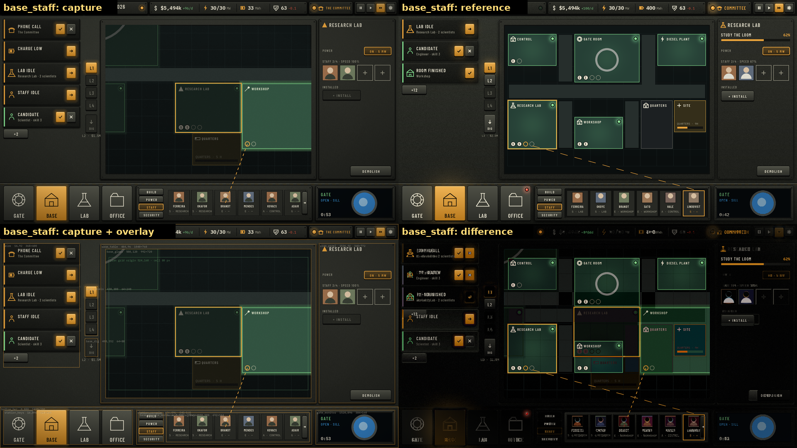

# M6 playtest: the Base station console

The Base tab is now a console in the reference's frame style (M6-01 to M6-07): the plan in
80 px cells with level keys and DIG, a room card on the right, and four modes in the tray
along the bottom: BUILD, POWER, STAFF and SECURITY. The pause menu and the save list
(pause, main menu, game over) use the same steel plates, keys and lamp switches. Captured
at 1920 × 1080 with `scripts/reference.sh` (software GL; lightmaps skipped).

## What to try

1. **BUILD:** pick a room card in the tray; a green ghost follows the cursor on the plan
   (red with the reason when it cannot go there); click or (A) to place. The site shows a
   progress bar until it is built.
2. **DIG:** after the Excavation survey research, DIG under the level keys starts level 2
   (the key shows "L2 0%"); when done, L2 opens the empty level.
3. **POWER:** each switchable room has a breaker; a press switches it (refusals say why).
   The tray's supply line and the top bar follow.
4. **STAFF:** drag a face tile onto the plan (or pick it, then click a room). While a person
   is held, rooms with a free slot for their role glow green and the rest dim; drop on a
   room to assign, on the tray to unassign.
5. **SECURITY:** HOLD and FALL BACK on the left, then a tile per squad (number, soldiers
   standing, order) and per blast door (where it is, OPEN or SEALED; a press toggles it).
   Pick a squad: its tag on the plan turns amber; hover a room to preview the path; click to
   order the move. Tags sit in the room's bottom-right corner.
6. **Pause (Esc / Start):** steel keys, lamp switches for gameplay and graphics, the QUALITY
   two-way switch; Save and Load open the restyled slot list.

## Modes

| | |
| --- | --- |
| BUILD  | POWER  |
| STAFF (an engineer held: the workshop glows)  | SECURITY (squad 1 picked, path to the workshop)  |

## Pause menu and saves

| | | |
| --- | --- | --- |
|  |  |  |

## Reference comparisons

## Tests

`tests/flow/test_m6_flow.gd` drives the running shell: build a room through the ghost, dig
level 2 from DIG, switch a room with its breaker, drop a face tile on a room, order a picked
squad to a room, and the pause menu's switch and save list. The soak passes.
